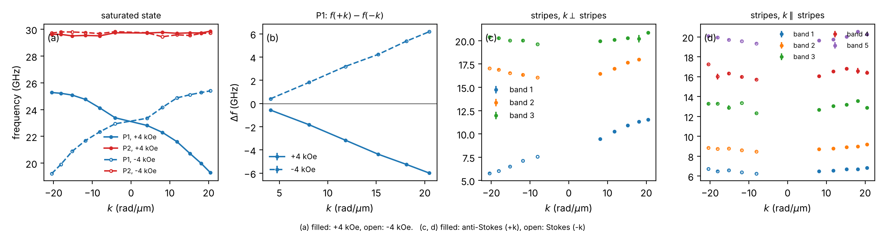
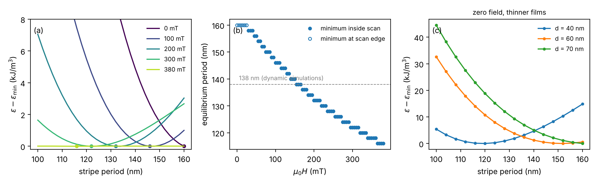

# stripe-domains-mumax3

[](https://github.com/Les-nik/stripe-domains-mumax3/actions/workflows/tests.yml)

MuMax3 simulations and analysis for

> A. K. Dhiman†, N. Leśniewski†, R. Gieniusz, J. Kisielewski, P. Mazalski, Z. Kurant, M. Matczak,
> F. Stobiecki, M. Krawczyk, A. Lynnyk, A. Maziewski, P. Gruszecki,
> "Reconfigurable magnonic crystals: Spin wave propagation in Pt/Co multilayer in saturated and
> stripe domain phase", *APL Materials* **12**(11), 111106 (2024).
> [doi:10.1063/5.0227380](https://doi.org/10.1063/5.0227380) († equal contribution)

## The system

A Pt/Co multilayer with perpendicular anisotropy forms stripe domains at remanence and saturates
in a strong in-plane field. The stripes are a periodic magnetization texture, so the same film
works as a magnonic crystal that can be switched on and off with the field. The experimental
co-authors measured the spin-wave dispersion with Brillouin light scattering (BLS) in both
phases; the simulations here reproduce and explain those spectra.

The multilayer is modelled as an effective medium of 58 layers (69.6 nm in total) with scaled
Ms and exchange, a reduced exchange between neighbouring layers (`ext_ScaleExchange`) standing
in for the Pt spacers, and Q = 0.6.



*BLS data. (a, b) In the saturated state the lowest mode is non-reciprocal and the sign of
f(+k) - f(-k) follows the field direction. (c, d) In the stripe phase the spectrum depends on
whether k is perpendicular or parallel to the stripes.*



*Equilibrium stripe period from MuMax3 energy scans: one period of the stripe pattern is relaxed
for periods of 100-160 nm and fields of 0-380 mT, and the period of lowest energy is kept.*

## Contents

| Path | Content |
| --- | --- |
| `simulations/stripes_k_perp.mx3` | stripe phase, k perpendicular to the stripes (28 periods of 138 nm) |
| `simulations/stripes_k_parallel.mx3` | stripe phase, k parallel to the stripes |
| `simulations/saturated.mx3` | saturated state, 500 mT in-plane |
| `simulations/energy_minimum_vs_field.mx3` | energy scan behind the stripe-period figure |
| `simulations/review/` | thinner-film variants added during the review |
| `data/bls/` | BLS frequencies as CSV (`raw/` keeps the original tables) |
| `data/energy/` | MuMax3 `table.txt` files of the energy scans |
| `data/simulations/` | reduced dynamic simulations (`scripts/reduce_run.py`) |
| `stripe_domains/` | data loaders and the energy-minimum analysis |
| `scripts/` | figure scripts |

## Reproducing

```bash
pip install -r requirements.txt
python scripts/fig_bls.py
python scripts/fig_stripe_period.py
```

The dynamic runs write several GB each. To compare them with BLS, run the `.mx3` files, then
reduce each output folder to a small file with
[spin-wave-dispersion](https://github.com/Les-nik/spin-wave-dispersion):

```bash
python scripts/reduce_run.py stripes_k_perp.out stripes_k_perp
python scripts/reduce_run.py stripes_k_parallel.out stripes_k_parallel --along y
python scripts/reduce_run.py saturated.out saturated
python scripts/fig_dispersion.py
```

## Data

The BLS measurements were made by the experimental co-authors of the paper and are included
with their agreement. `data/bls/README.md` describes the columns.

## License

Code: MIT. Data: CC BY 4.0. Please cite the article when using either.
